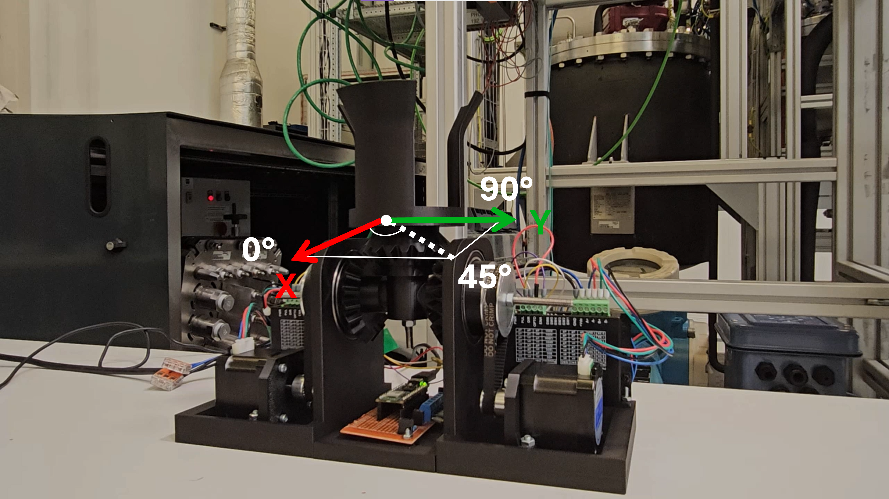
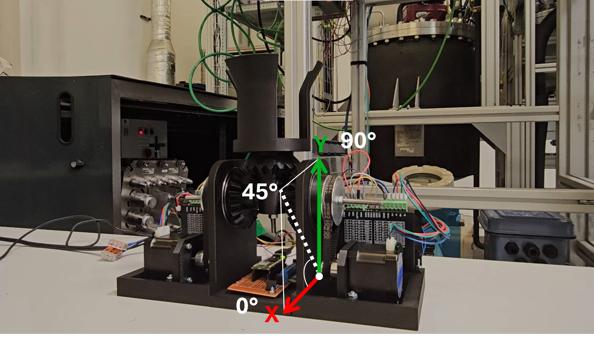
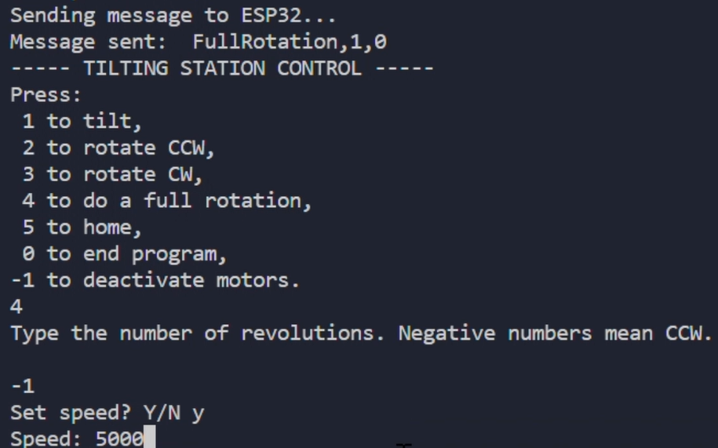

# **Tilting station control**
> ### **Note:** 
>***Before use, align the top gear so that the station is upright.***

## **Coordinate systems**
#### **Rotation**

#### **Tilt**

## **Preparation**

Connect the motor power supply, then the ESP32. It will take 10 seconds to establish the Access Point, after which, the station will tilt to 94°, this solves a problem with an offset. After this movement, the station is ready to be used.

Ensure the ESP32 and the robot/computer share the same network before use. The user program attempts connection (often successfully) to the ESP32 Access Point, but check manually just to be sure. 

Type a number to choose one of the following modes, after which you will type in the position and if you'd like to change the speed.

You can change the code to bypass this, and directly write the message to be sent to the ESP32. 
> message = f"{movement},{position},{speed}"

The speed refers to the **wait time ($\mu s$)** between each pulse sent to the motor; thus, **a bigger value for the wait time will result in a slower movement.**
A speed of 0 will be understood as the default wait time, as well as any value under 1000 $\mu s$.

## **Modes**
+ **0 - End Python script** \
End the user script. Use this mode after motors are deactivated, and you want to close the program. Useful when you want to reconnect to the ESP32 socket.
+ **-1 - Deactivate motors** \
Send a LOW, LOW signal to the ENABLE pins on both motors, de-energizing them. Useful when you want to manually move the gear position.  
***
+ **1 - Tilting** \
Choose a position between 0° and 180° to tilt the container. See axis on picture. Preferably work with positions with a difference greater than 5°, e.g.: \
$|~{new~position~tilt} - {current~position~tilt}~| \geq 5°$
+ **2 - Rotation (CCW)** \
Choose a position between 0° and 359° and the top gear will rotate **counter-clockwise** to the desired position. See axis on picture. 
+ **3 - Rotation (CW)** \
Choose a position between 0° and 359° and the top gear will rotate **clockwise** to the desired position. See axis on picture. 
+ **4 - Multiple revolutions** \
Perform as many (whole) revolutions as desired, returning to the initial rotation position, whatever it may be. \
For numbers lesser than 0, the movement will be **counter-clockwise**. \
For numbers greater than 0, the movement will be **clockwise**. 
+ **5 - Rotate for time** \
*Work in progress.*
***
+ **6 -  Go home**\
Return to tilt 0° and rotation 0°. Gears will move in whichever direction is closest to 0. \
**Note:** The home position is established as the initial position the structure had when the ESP32 program started. Therefore, ensure the station is upright before turning the controller on. 
***

