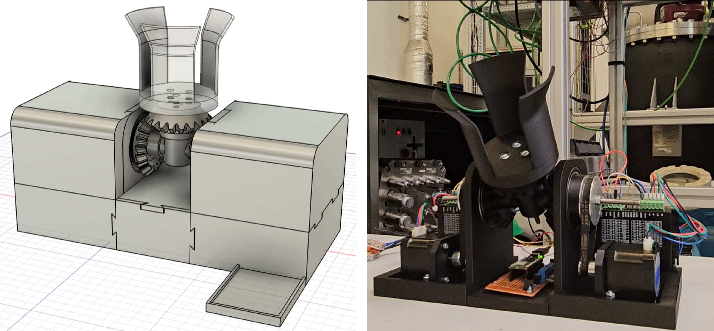

# **tilting_station_rox**
Repository for the tilting station developed as an aid to project ROX. \
Please read the **OperatingInstructions.md** file, where you'll find the series of steps for the proper operation of the tilting station.

## **Code**
### **Arduino scripts**
The tilting_station folder includes 3 files:
+ The main .ino file where the setup and main functions are ran.
+ pins_and_variables.h as an additional file to maintain readability.
+ other_functions.h includes the movement and communication functions, separated to maintain readability.

### **Python scripts**
The Python script user_program.py, as its name implies, is the code ran by an external computer to send the control signals to the ESP32. Make sure both devices are connected to the same network. Read OperatingInstructions.md to learn more.

## **Design**
You'll find three files in the design folder.
+ A .3mf Fusion file, as an assembly of all parts.
+ An .stl file for the *inner* structure, to be separated into parts.
+ An .stl file for the *outer* structure, to be separated into parts.

The individual files can be found in the Fusion Cloud under the address: *INVITE Robotics/ROX/TiltingStation/*

### **List of components**
The assembly has **10** pieces in total, being:
+ 2 side gears
+ 2 side structure L pieces
+ 1 container holder
+ 1 top gear
+ 1 coupling
+ 1 connecting middle piece
+ 2 NEMA 17 motor brackets

Additional non-printable components include:
+ 2 NEMA 17 motors
+ 2 DM320T drivers
+ 2 60T pulleys (5mm bore)
+ 2 20T pulleys (5mm bore)
+ 2 rubber belts
+ 2 45mm ball bearings
+ 1 7mm ball bearing
+ 3 M5 screws for the gears
+ M4 and M3 screws and nuts

## **Other files**
### **Electrical configuration**
You'll find a chart displaying the cable configuration for the motor drivers and the ESP32. 
### **Accuracy and other measurements**
You'll find an Excel file with data and graphs of measurements taken to calculate the degree offset for tilting.
